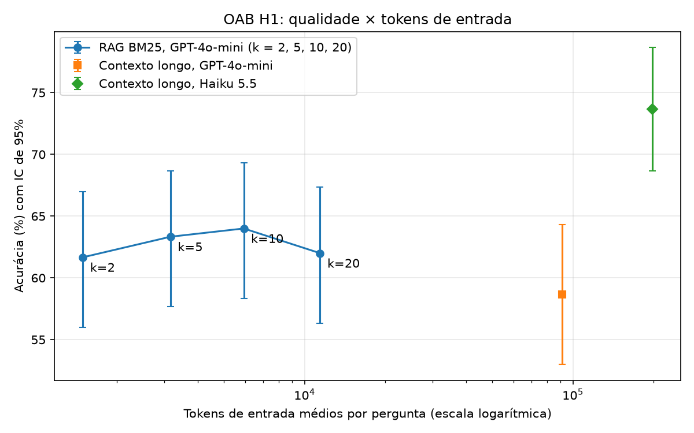

# Replicação do MemoryAgentBench: RAG e contexto longo, nos dados do autor e na OAB

**Residência em IA (UFG) · Experimento 2 · Pedro Coelho**

O Experimento 1 comparou memória passiva e ativa numa conversa sintética pequena, em que o contexto longo bastava. O Experimento 2 testa duas afirmações de um artigo revisado por pares, o MemoryAgentBench (Hu, Wang e McAuley, ICLR 2026), para saber se o autor estava certo:

- **H1.** O RAG vence o contexto longo quando é preciso achar um trecho preciso (achado 1 do artigo, §4.2).
- **H2.** O contexto longo vence o RAG quando é preciso aprender com exemplos (achado 2, §4.2).

Cada afirmação passa por duas etapas. A **direta** usa o código, os dados e o protocolo do autor, com o GPT-4o-mini, para ver se o número do artigo se repete. A **conceitual** leva a mesma afirmação para as questões da OAB, com o corpus de leis do projeto Atlas, para ver se ela vale fora dos dados do autor; nela entram o GPT-4o-mini e o Haiku 5.5. Rodar só na OAB não separaria "o autor errou" de "lei é diferente do que ele testou"; a etapa direta separa.

- Desenho, com as regras de decisão: [`superpowers/specs/2026-11-10-replicacao-memoryagentbench-design.md`](superpowers/specs/2026-11-10-replicacao-memoryagentbench-design.md)
- Código do autor e cada adaptação: [`../replica/autor/NOTICE.md`](../replica/autor/NOTICE.md)
- Resultados: [`../resultados/20261110-direta/tabela.md`](../resultados/20261110-direta/tabela.md), [`../resultados/20261110-oab/tabela.md`](../resultados/20261110-oab/tabela.md), a repetição da janela de depuração em [`../resultados/20261110-depuracao/`](../resultados/20261110-depuracao/) e o piloto em [`../resultados/piloto-20261110/`](../resultados/piloto-20261110/)

**O resultado em poucas linhas.** As quatro comparações primárias usam o GPT-4o-mini e o par contexto longo × RAG BM25. Duas confirmam o artigo, duas são inconclusivas, e nenhuma o contraria. A diferença é sempre RAG − contexto longo, com o intervalo de 95%:

- **H1 direta: confirmada e reproduzida.** No MH-Doc QA, o BM25 acertou 56,0% [46,0; 66,0] e o contexto longo 42,0% [32,0; 52,0], +14,0 pp [+2,0; +26,0]. Os números do artigo, 56,0 e 43,0, caem nos nossos intervalos.
- **H2 direta: inconclusiva.** Nas cinco MCC (500 perguntas), o contexto longo acertou 77,0% [73,4; 80,4] e o BM25 76,8% [73,4; 80,2], −0,2 pp [−2,8; +2,4]. O BM25 reproduz o artigo (75,4). A média do contexto longo **não reproduz**: os 82,0 da Tabela 3 do artigo e os 82,4 da média da Tabela 7 ficam acima do intervalo.
- **H1 OAB: confirmada.** Com a lei da matéria como memória, em 300 questões, o BM25 acertou 64,0% [58,3; 69,3] e o contexto longo 58,7% [53,0; 64,3], +5,3 pp [+1,7; +9,0].
- **H2 OAB: inconclusiva.** Com as provas antigas como exemplos, em 224 questões, o BM25 acertou 66,1% [59,8; 72,3] e o contexto longo 65,2% [58,9; 71,4], +0,9 pp [−3,6; +5,4].

A não reprodução da média do contexto longo nas MCC abriu a janela de depuração da etapa direta, que fechou no mesmo dia. O nosso código manda ao modelo a mesma requisição que o código do autor mandaria, e uma repetição paga do TREC fine (52 de 100, contra 56 na rodada) mostrou que o ruído da temperatura não explica a distância. Sobram duas explicações que não dá para separar: o GPT-4o-mini servido hoje e os dados com que o artigo rodou as MCC. Na OAB, o contexto longo custou de 1,5 a 14,2 vezes mais que o BM25. Ficou incompleta só a reprodução das MCC por embedding, que parou no teto de gasto com 266 de 500 perguntas.

## 1. O que foi replicado e o que não foi

Situação de cada comparação ao fim das rodadas, em 2026-11-10:

| Comparação | Configurações | Perguntas | Situação |
|---|---|---|---|
| H1 direta (primária) | contexto longo × RAG BM25, GPT-4o-mini, MH-Doc QA | 100 | completa: **confirmada**; os dois braços reproduzem o artigo |
| H2 direta (primária) | contexto longo × RAG BM25, GPT-4o-mini, as cinco MCC | 500 | completa: **inconclusiva**; o BM25 reproduz o artigo, a média do contexto longo não |
| Reprodução do RAG por embedding no MH-QA | `text-embedding-3-small`, leitor GPT-4o-mini | 100 | completa: reproduz |
| Reprodução do RAG por embedding nas MCC | idem | 500 | **incompleta**: parou no teto com 266 de 500 (BANKING77 e CLINC150 completos, NLU com 66 de 100, os dois TREC sem nenhuma); a média fica sem teste |
| H1 OAB (primária) | contexto longo × RAG BM25, GPT-4o-mini | 300 | completa: **confirmada** |
| H2 OAB (primária) | idem | 224 | completa: **inconclusiva** |
| Linhas de base sem memória | GPT-4o-mini e Haiku 5.5 | 3.377 cada | completas |
| Secundárias do Haiku | contexto longo, RAG BM25 e RAG por embedding, na H1 e na H2 da OAB | 300 e 224 | completas |
| Secundárias da OpenAI na OAB | RAG por embedding na H1 e na H2, ablação de k (2, 5 e 20), BM25 no corpus inteiro | 300 ou 224 | completas |
| Repetição da janela de depuração | contexto longo, GPT-4o-mini, TREC fine | 100 | completa (seção 5.2) |

### A parada por falta de saldo

A rodada da etapa direta parou depois do MH-QA completo e de 170 perguntas das MCC no contexto longo: a API da OpenAI devolveu 429 com a mensagem "You have no credits remaining", com US$ 3,29 no livro-caixa. O saldo pré-pago acabou muito antes da trava de US$ 20 do painel e do teto de US$ 19,50 do livro-caixa, que limitam o gasto mas não garantem que haja saldo. O cliente reconhecia a falta de saldo só pelo código `insufficient_quota`; desde `fff61c6`, reconhece também o texto da mensagem e para a configuração na hora (`LimiteDoPainel`). Enquanto a OpenAI estava sem crédito, rodaram as quatro configurações do Haiku que usam só a Anthropic (BM25 e contexto longo, na H1 e na H2). Os tetos são por provedor, e isso não tirou orçamento de nenhuma primária.

O Pedro pôs US$ 17 de crédito na OpenAI por volta das 11:25. Um vigia, que fazia uma chamada de 1 token a cada 15 minutos pelo livro-caixa, viu o crédito às 11:31 e retomou sozinho, na ordem do plano e sem a reserva, o resto da etapa direta (11:31 a 12:17) e as quatro primárias da OAB (12:17 a 13:09). Depois, com a reserva, rodaram a repetição da janela de depuração (seção 5.2), as oito secundárias da OAB e, por último, a reprodução das MCC por embedding, até o teto. As decisões são do Claude (seção 6.2). Cada resposta é gravada logo que chega, e a retomada só responde o que falta e refaz as linhas com erro de API: nada do que foi pago se perdeu, e no fim nenhuma configuração ficou com erro de API, recusa ou resposta vazia. O livro-caixa fechou em US$ 19,4963 na OpenAI, no limite do teto de US$ 19,50, e em US$ 20,2306 na Anthropic, de um teto de US$ 29,50.

### O que ficou fora por desenho

- **Cinco dos seis modelos de contexto longo do artigo.** O Claude 3.7 Sonnet (saiu em 2026-02-19) e o Gemini 2.0 Flash (2026-06-01) já não existem na API; o GPT-5-mini sai em 2026-12-11; o GPT-4o custaria sozinho mais que o teto; a configuração mais barata do GPT-4.1-mini passaria de US$ 4 (Correção 11 do desenho). Fica o GPT-4o-mini, que é também o leitor de todos os agentes RAG do artigo. O Haiku 5.5 entra só na OAB, como a extensão atual.
- **A metade "compreensão de longo alcance" do achado 2.** A tarefa de resumo depende do GPT-4o como juiz, e o Detective QA tem só 71 perguntas.
- **O achado 3, esquecimento seletivo**, por decisão do Pedro. Na OAB também não haveria como testá-lo: o corpus não guarda versões de lei.
- **Os agentes agênticos** (MemGPT, MIRIX, Self-RAG) **e os RAG com estrutura** (GraphRAG, HippoRAG, Mem0 e outros), pelo orçamento e porque as duas afirmações não dependem deles.
- **As ablações do artigo** (tamanho de chunk e top-k), por decisão do Pedro. A única ablação do experimento é a de k na OAB H1 (seção 4.2).

## 2. As regras de decisão, como foram registradas

O desenho registrou, antes de qualquer rodada, esta regra (seção 2 do desenho, "Regra de decisão (registrada antes de rodar)"):

> - **Uma comparação primária por afirmação e etapa**, quatro ao todo (H1 direta, H2 direta, H1 OAB, H2 OAB). A primária é sempre o par que o artigo reporta: **GPT-4o-mini com contexto longo × GPT-4o-mini com RAG BM25**. Só a primária dá veredito.
> - Na H2 direta, as cinco MCC entram juntas na primária: 500 perguntas, com o bootstrap reamostrando dentro de cada dataset (item 7 de "Correções depois da leitura do código do autor (2026-11-10)"). O resultado por dataset é secundário.
> - **Secundárias** (RAG por embedding × contexto longo, os pares do Haiku, cada dataset separado, a ablação de k) são reportadas com intervalo, sem veredito. Se divergirem da primária, a divergência vai para o documento e é discutida, mas não muda o veredito.
> - Sem correção para múltiplas comparações entre as quatro primárias: cada uma responde uma pergunta diferente, registrada antes.
> - Comparações sempre pareadas: as mesmas questões em todas as configurações.
> - Intervalo de 95% por bootstrap pareado (10.000 reamostragens) para a diferença de acurácia.
> - **Confirmada** se o intervalo exclui zero na direção do artigo. **Contrariada** se exclui zero na direção oposta. **Inconclusiva** se contém zero. Inconclusivo é resultado e vai para o documento como está.
> - Na etapa direta há um segundo teste: o número do artigo cai dentro do nosso intervalo de 95%? Se cai, a medida foi reproduzida.
> - Com 100 perguntas, o intervalo de uma acurácia isolada tem uns ±9 pontos; a diferença pareada é mais estreita. Diferenças de 2 a 3 pontos não são detectáveis neste orçamento, e o documento diz isso.

A ordem dos commits mostra que a regra veio antes dos dados:

| Commit | Hora (2026-11-10) | O que entrou |
|---|---|---|
| `6e8e707` | 01:36 | desenho original, já com a regra (a H2 direta tinha só BANKING77 e CLINC150) |
| `577fb2e` | 02:52 | desenho com as "Correções depois da leitura do código do autor"; a seção da regra fica com o texto atual |
| `bf903e9` | 04:41 | primeiro commit em `resultados/`: snapshot, reclassificação de matéria e livro-caixa, sem nenhuma resposta dos agentes |
| `dd3d6b2` | 06:34 | piloto e "Decisões do piloto" |
| `6003a15` | 07:22 | rodada direta parcial e linhas de base da OAB |
| `fc1b412` | 08:07 | rodada da OAB só com o Haiku |
| `4929dc3` | 14:36 | resto da etapa direta, repetição do TREC fine e rodada da OAB com a OpenAI |

A seção da regra tem o mesmo texto em `577fb2e` e na versão atual do desenho (conferido com `git diff`). Entre `6e8e707` e `577fb2e` mudou uma linha: a H2 direta passou de duas MCC para as cinco (Correção 7), porque nos dois datasets do desenho a diferença do artigo é de 4 pontos (93 × 89), que 200 perguntas não detectam com segurança; o Pedro aprovou. Depois do piloto houve uma decisão que muda como a H2 direta é medida, sem mexer na regra: a leitura flexível de `label:` como métrica das MCC (seção 5.2). Ela foi tomada pelo Claude, a partir do formato das respostas de 10 perguntas do piloto, antes da rodada completa.

## 3. Método

### 3.1 O código é o do autor

O código dos três agentes (contexto longo, RAG BM25 e RAG por embedding), os templates de prompt e as métricas vêm do repositório do autor, de licença MIT, no commit fixado `538026089d1a8a8eff05121d0db89b388f360eba`. Os dados vêm do Hugging Face `ai-hyz/MemoryAgentBench`, revisão `7ea066982b140a19337e17e60d45d4076e042faf`. O `templates.py` é idêntico byte a byte (um teste confere o sha256). O `metricas.py` e o `agente.py` têm só as funções e os métodos usados, com os nomes e os corpos do autor. As adaptações, todas descritas no `NOTICE.md`:

1. **Toda chamada de LLM passa pelo cliente com teto de gasto** (`replica.clientes`), que registra no livro-caixa os tokens normais, cacheados e escritos no cache. No contexto longo, o contexto vai como prefixo cacheável e a pergunta como mensagem; o texto enviado é o mesmo do autor. A temperatura fica no cliente (0,7 na OpenAI).
2. **O Haiku recebe a mensagem de sistema.** O caminho do Claude no código do autor a omitia; o Haiku não está no artigo, e fica com o mesmo prompt dos agentes da OpenAI.
3. **BM25 sem LangChain:** `rank_bm25.BM25Okapi` com tokenização por `str.split()`, sem minúsculas, que é o que o `BM25Retriever` do LangChain faz por dentro.
4. **Embedding sem LangChain, FAISS nem Azure:** produto interno entre vetores normalizados com numpy, que dá a mesma ordem do FAISS L2 do autor sobre os vetores do `text-embedding-3-small`. O caminho do autor exigia Azure; aqui vai pelo cliente normal da OpenAI.
5. **A extração da consulta do RAG ganha um padrão em português** (`Agora responda à questão:`), depois dos dois do autor, para a OAB.
6. **Templates por uma função injetável**, para a OAB plugar os seus; o padrão é o `get_template` do autor.
7. **Sem torch, transformers, LangChain, Azure nem gravação em `./outputs/`.** O trecho recuperado volta para o rodador, que o guarda na linha da resposta.

Fora do código do autor, o cliente de embeddings fecha cada pedido em até 250 mil tokens estimados e trunca em 8.191 tokens (`cl100k_base`) qualquer trecho maior, com aviso, porque a API recusa acima disso; o modelo do autor é o mesmo, com o mesmo limite. Numa conferência feita para este documento, nenhum trecho da OAB nem do MH-QA passa desse limite: o maior da H1, com chunks de 512, tem 5.482 tokens (no CC), e o "artigo" de 12.841 tokens do CPC é quebrado em frases antes de virar trecho. Nas MCC, com chunks de 4096, 2 trechos passam. Na reprodução das MCC por embedding, o log avisou o truncamento dos dois, e o embedding de cada um foi calculado sem a cauda.

Nas métricas, o `calculate_metrics` deixou de calcular o ROUGE, que o experimento não usa, e o `post_process` ficou só com os ramos das tarefas usadas. Foram mantidos de propósito os comportamentos do autor que um leitor estranharia: o carimbo de hora no template de memorização, o truncamento do contexto longo a cada pergunta, o descarte do trecho mais antigo no RAG quando a memória passa do limite, e o trecho vazio que o fatiador pode gerar.

### 3.2 Parâmetros

| Parâmetro | Valor | Origem |
|---|---|---|
| top-k do RAG | 10 | autor |
| chunk do contexto longo | 4096 tokens | autor |
| chunk do RAG | 512 no MH-QA e na OAB H1; 4096 nas MCC e na OAB H2 | autor; na OAB, por analogia (Correção 8) |
| teto de saída | 50 tokens no MH-QA; 20 nas MCC e na OAB | autor (Correção 2) |
| `input_length_limit` / `buffer_length` | contexto longo do GPT-4o-mini 128.000 / 4.000; BM25 10.000.000 / 200; embedding 300.000 / 15.000; contexto longo do Haiku 1.000.000 / 480.000 | autor; o Haiku segue a convenção do autor para o Claude (Correção 12) |
| amostragem | temperatura 0,7 na OpenAI; o Haiku usa a padrão, porque a API recusa `temperature` | autor (Correção 1) |
| métrica | MH-QA: `substring_exact_match`. MCC: leitura flexível de `label:` (primária) e `exact_match` estrito (ao lado). OAB: letra extraída por regex | README do autor; Decisões do piloto |
| cache | ligado nas duas APIs | o artigo calcula os custos com cache (Apêndice I) |

O cache é o contrário da regra do Experimento 1, que o proibiu para a contagem de tokens ter um significado só. Aqui ele é obrigatório: sem cache, a Anthropic passaria de US$ 140. No piloto, as chamadas 2 a 10 das seis configurações de contexto longo vieram com 99% a 100% da entrada cacheada.

**Contexto longo não é contexto inteiro.** O agente de contexto longo do autor trunca a memória para caber em `input_length_limit − buffer_length` e guarda o fim. Com o GPT-4o-mini, isso dá uns 124 mil tokens: no MH-QA, cujo contexto tem ~421 mil, ele vê menos de um terço. As 100 perguntas do contexto longo somaram 12.402.749 tokens de entrada, ~124 mil por pergunta. O RAG BM25 indexa tudo. É o protocolo do artigo, e pesa na leitura da H1 (seções 5.1 e 5.3). Nas MCC, a entrada do contexto longo tem ~104 a 107 mil tokens e cabe inteira.

### 3.3 Adaptações para a OAB

- **Prompts em português**, que imitam os templates do autor para o `ruler_qa` (H1) e o `in_context_learning` (H2), copiados de [`../replica/templates_oab.py`](../replica/templates_oab.py):

```python
SYSTEM_OAB = "Você é um assistente prestativo que lê o contexto e o memoriza para consultas futuras."
INSTRUCAO_LETRA = "Responda apenas com a letra da alternativa correta (A, B, C ou D) e não escreva mais nada."

# H1, pergunta ao contexto longo (o RAG troca "Questão:" por "Agora responda à questão:")
"Responda à questão com base nos documentos memorizados. " + INSTRUCAO_LETRA + " \n\nQuestão: {question} \n\n Resposta:"

# H2, pergunta ao contexto longo (o RAG usa "Questão:{question}")
"Use os exemplos do contexto, questões da prova da OAB com o gabarito, para responder à nova questão. Responda apenas \"Gabarito: {{letra}}\" e nada mais. \n\n{question} \n\n Gabarito:"
```

- **A consulta do RAG.** Na H1, a consulta é o texto depois de "Agora responda à questão:", isto é, o enunciado com as alternativas. Na H2, como nas MCC do autor, nenhum padrão casa, e a consulta é a mensagem inteira.
- **Resposta por letra.** A letra é extraída por regex, e letra inválida conta como erro. No piloto, nenhuma configuração teve letra inválida.
- **Haiku sem raciocínio** (`thinking: {type: "disabled"}`), para ficar comparável ao GPT-4o-mini, que não raciocina.
- **H1: a lei da matéria.** 300 questões das provas de 2018 a 2023, sorteadas (semente 42) e estratificadas pela matéria reclassificada (seção 3.5), sem Filosofia e Internacional. Cada matéria aponta para uma ou mais leis (Civil → CC, Processo Civil → CPC, Ética → EAOAB, Regulamento Geral e CED, e assim por diante), o que dá 15 contextos; o maior tem 264.994 tokens `o200k` (o CPC). O contexto longo e o RAG recebem a mesma lei e diferem só em como a leem, que é o ponto do artigo. O contexto longo do Haiku vê cada lei inteira. O do GPT-4o-mini vê só o fim dos 7 contextos que passam de ~124 mil tokens: CPC (264.994), CC (168.882), o bloco de Administrativo (166.678), CF (166.086), CLT (144.456), o bloco de Empresarial, com as Leis 6.404 e 11.101 (138.613), e o bloco de Eleitoral (136.996). Esses 7 contextos têm 159 das 300 questões; os outros 8 cabem inteiros.
- **H1, variante "corpus inteiro":** o BM25 sobre todas as leis (1.755.201 tokens `o200k`), só com BM25, porque o agente de embedding do autor guardaria só os últimos ~285 mil tokens (Correção 9).
- **H2: as provas antigas como exemplos.** A memória são 3.057 questões de até 2023, em ordem cronológica, cada uma seguida de "Gabarito: X" (775.322 tokens `o200k`). O teste são as 224 questões de 2024 e 2025 (229 antes dos filtros), depois do corte de treino do GPT-4o-mini (outubro de 2023, segundo fontes secundárias). Sai da memória toda questão antiga com enunciado quase igual ao de uma questão de teste (razão do `SequenceMatcher` acima de 0,8), e saem as duplicatas conhecidas (prova 2018-01 ≈ 2018-25, `2022-02-3` e `2022-02-3-fixed`). O contexto longo vê as questões mais recentes que cabem: no Haiku, ~520 mil tokens `o200k` (~890 mil do tokenizador dele), cerca de dois terços da memória; no GPT-4o-mini, ~124 mil, cerca de um sexto. O RAG usa chunks de 4096 tokens, e cada busca traz ~160 questões antigas (~41 mil tokens).
- **BM25 em português com a tokenização do autor.** O `str.split()` não passa o texto para minúsculas e deixa a pontuação grudada na palavra: "Lei", "lei" e "lei," são termos diferentes, e não há stemmer. O desenho (§5) sugeria um stemmer de português e deixava a escolha para quem construísse (§12); o plano manteve a tokenização do autor, por fidelidade. Isso pode prejudicar o RAG na OAB (seção 5.4).
- **Linhas de base sem memória:** as 3.377 questões válidas de todos os anos (as 3.395 do banco menos 18 com menos de quatro alternativas), nos dois modelos.

### 3.4 Vazamento de gabarito

A tabela `embeddings` do banco do Atlas tem 2.210 linhas de questões de 2010 a 2018 com o gabarito. Nada do experimento usa essas linhas: o RAG da H1 indexa só os artigos de lei, e os embeddings são gerados de novo, localmente. A revisão final do código conferiu, e as contas foram refeitas para este documento sobre os arquivos de `dados/oab/`:

- o par mais parecido entre a memória da H2 (3.057 questões) e as 224 questões de teste tem Jaccard de 4-gramas de palavras de 0,053;
- o par mais parecido dentro da amostra da H1 (300 questões) tem 0,052;
- nenhum dos 15 contextos da H1 contém o começo (120 caracteres) de nenhuma das 300 questões;
- as questões de teste da H2 estão todas na linha de base sem memória, e a H1 e a H2 não têm nenhuma questão em comum.

### 3.5 Reclassificação de matéria

Os rótulos de matéria do banco são ruins depois de 2018, e é o rótulo que decide qual lei o agente recebe na H1. As 953 questões de 2018 a 2023 que sobram depois dos filtros foram reclassificadas pelo GPT-4o-mini, com temperatura 0. A regra do plano: conferir à mão uma amostra de 30 e aprovar com até 3 erros.

- **Rodada 1, reprovada:** 4 erros em 30 ([`conferencia-materias-rodada1.md`](conferencia-materias-rodada1.md)). O modelo puxava para o ECA questões de Direito Civil que só têm um menor ou uma pessoa com deficiência na história, e tirava de Administrativo questões sobre servidor público e Lei Anticorrupção. Nas 30 linhas, a matéria certa coincidia com o bloco da prova da FGV pelo número da questão (1 a 8 Ética, 9 e 10 Filosofia, 11 a 17 Constitucional, e assim por diante).
- **Rodada 2, aprovada:** o prompt passou a informar o número da questão e a ordem dos blocos da FGV. Numa amostra nova (semente 43), 0 erro em 30 ([`conferencia-materias.md`](conferencia-materias.md)).

Restaram 65 das 953 questões (6,8%) com matéria fora do bloco da FGV, nenhuma na amostra da rodada 2, várias repetindo erros da rodada 1. Como o contexto longo e o RAG recebem a mesma lei em cada questão, esse ruído afeta os dois braços igualmente e não favorece nenhum deles. Mas não é neutro: numa questão com a lei errada, os dois braços leem um texto que não ajuda, o que puxa a diferença para zero e a comparação para "inconclusiva". **As duas conferências foram feitas pelo Claude, porque a sessão rodou sem o Pedro, e são provisórias até o Pedro reconferir.**

### 3.6 Análise

As comparações são pareadas por `pergunta_id`. A diferença é sempre RAG − contexto longo: a H1 espera diferença positiva, a H2 negativa. O intervalo de 95% vem de um bootstrap pareado com 10.000 reamostragens, que nas MCC reamostra dentro de cada dataset. Linhas com erro contam como erradas. Configuração em que falta resposta final para alguma pergunta esperada fica "parcial" e sem veredito nem teste de reprodução.

O comando `analise` gera as primárias, com veredito; as comparações secundárias contexto longo × RAG registradas no desenho (embedding ou BM25), com intervalo e sem veredito, na seção "Comparações secundárias" da `tabela.md`; a reprodução; as acurácias; os custos; e o gráfico. Ficam fora da `tabela.md` só as comparações **exploratórias, não registradas** no desenho: memória × sem memória, nos dois modelos; GPT-4o-mini × Haiku sem memória; o Haiku sem memória contra os braços com memória do GPT-4o-mini; e, na H1 da OAB, a primária separada entre os contextos que o GPT-4o-mini vê inteiros e os que ele vê só pelo fim. Os pares foram calculados à parte com a mesma função (`replica.analise.bootstrap_pareado`, semente 42, 10.000 reamostragens), pareando por `pergunta_id` a resposta final de cada pergunta em cada JSONL, com a linha de base restrita às questões da H1 ou do teste da H2. São muitas comparações, nenhuma com correção para multiplicidade: entre elas, um intervalo que exclui zero pode aparecer por acaso.

## 4. Resultados

### 4.1 Etapa direta

Rodada em `resultados/20261110-direta/`. As linhas da H1 e da H2 direta da tabela de primárias, coladas de `tabela.md` sem edição (as linhas da OAB dessa tabela dizem "não rodada", porque a OAB está na outra pasta):

| Comparação | n | Contexto longo | RAG BM25 | Diferença | Veredito | Nota |
|---|---|---|---|---|---|---|
| H1 direta | 100 | 42.0% [32.0%; 52.0%] | 56.0% [46.0%; 66.0%] | +14.0 pp [+2.0; +26.0] | confirmada |  |
| H2 direta | 500 | 77.0% [73.4%; 80.4%] | 76.8% [73.4%; 80.2%] | -0.2 pp [-2.8; +2.4] | inconclusiva |  |

- H2 direta, `exact_match` estrito (literal do README), nas mesmas 500 perguntas: contexto longo 0.0%, RAG BM25 0.0%.

As comparações secundárias registradas (contexto longo × embedding), coladas sem edição da seção "Comparações secundárias":

| Comparação | n | Contexto longo | RAG | Diferença | Nota |
|---|---|---|---|---|---|
| H1 direta: contexto longo × embedding | 100 | 42.0% [32.0%; 52.0%] | 45.0% [35.0%; 55.0%] | +3.0 pp [-6.0; +13.0] |  |
| H2 direta: contexto longo × embedding | 266 | 87.6% [83.5%; 91.4%] | 88.7% [85.0%; 92.5%] | +1.1 pp [-1.5; +4.1] | parcial (266 de 500) |

- H2 direta: contexto longo × embedding: 234 pergunta(s) de `direta-mcc-lc-4omini` e 0 de `direta-mcc-emb-4omini` descartadas por não estarem nas duas configurações (ou fora das perguntas esperadas).

A secundária da H2 é parcial: as 266 perguntas são as do BANKING77, do CLINC150 e de parte do NLU, sem os dois TREC, e por isso as acurácias dela não se comparam às das 500.

A seção de reprodução, colada sem edição. Nas MCC, "Nossa acurácia" é a leitura flexível de `label:`, e a coluna do estrito é o `exact_match` literal do README:

| Configuração | Fonte | n | Nossa acurácia | Artigo | Reproduz | Estrito (literal do README) | Nota |
|---|---|---|---|---|---|---|---|
| direta-mhqa-lc-4omini | ruler_qa2_421K | 100 | 42.0% [32.0%; 52.0%] | 43.0% | sim |  |  |
| direta-mhqa-bm25-4omini | ruler_qa2_421K | 100 | 56.0% [46.0%; 66.0%] | 56.0% | sim |  |  |
| direta-mcc-lc-4omini | icl_banking77_5900shot_balance | 100 | 89.0% [83.0%; 95.0%] | 93.0% | sim | 0.0% [0.0%; 0.0%] |  |
| direta-mcc-lc-4omini | icl_clinic150_7050shot_balance | 100 | 88.0% [81.0%; 94.0%] | 93.0% | sim | 0.0% [0.0%; 0.0%] |  |
| direta-mcc-lc-4omini | icl_nlu_8296shot_balance | 100 | 84.0% [77.0%; 91.0%] | 87.0% | sim | 0.0% [0.0%; 0.0%] |  |
| direta-mcc-lc-4omini | icl_trec_coarse_6600shot_balance | 100 | 68.0% [59.0%; 77.0%] | 73.0% | sim | 0.0% [0.0%; 0.0%] |  |
| direta-mcc-lc-4omini | icl_trec_fine_6400shot_balance | 100 | 56.0% [46.0%; 65.0%] | 66.0% | não | 0.0% [0.0%; 0.0%] |  |
| direta-mcc-lc-4omini | média MCC | 500 | 77.0% [73.4%; 80.4%] | 82.0% | não | 0.0% [0.0%; 0.0%] |  |
| direta-mcc-bm25-4omini | icl_banking77_5900shot_balance | 100 | 92.0% [86.0%; 97.0%] | 89.0% | sim | 0.0% [0.0%; 0.0%] |  |
| direta-mcc-bm25-4omini | icl_clinic150_7050shot_balance | 100 | 87.0% [80.0%; 93.0%] | 89.0% | sim | 0.0% [0.0%; 0.0%] |  |
| direta-mcc-bm25-4omini | icl_nlu_8296shot_balance | 100 | 83.0% [75.0%; 90.0%] | 84.0% | sim | 0.0% [0.0%; 0.0%] |  |
| direta-mcc-bm25-4omini | icl_trec_coarse_6600shot_balance | 100 | 70.0% [61.0%; 79.0%] | 62.0% | sim | 0.0% [0.0%; 0.0%] |  |
| direta-mcc-bm25-4omini | icl_trec_fine_6400shot_balance | 100 | 52.0% [42.0%; 62.0%] | 53.0% | sim | 0.0% [0.0%; 0.0%] |  |
| direta-mcc-bm25-4omini | média MCC | 500 | 76.8% [73.4%; 80.2%] | 75.4% | sim | 0.0% [0.0%; 0.0%] |  |
| direta-mhqa-emb-4omini | ruler_qa2_421K | 100 | 45.0% [35.0%; 55.0%] | 44.0% | sim |  |  |
| direta-mcc-emb-4omini | icl_banking77_5900shot_balance | 100 | 91.0% [85.0%; 96.0%] | 88.0% | sim | 0.0% [0.0%; 0.0%] |  |
| direta-mcc-emb-4omini | icl_clinic150_7050shot_balance | 100 | 89.0% [82.0%; 95.0%] | 89.0% | sim | 0.0% [0.0%; 0.0%] |  |
| direta-mcc-emb-4omini | icl_nlu_8296shot_balance | 66 | 84.8% [75.8%; 92.4%] | 83.0% | sem teste | 0.0% [0.0%; 0.0%] | parcial (66 de 100) |
| direta-mcc-emb-4omini | icl_trec_coarse_6600shot_balance | não rodada |  |  |  |  | parcial (0 de 100) |
| direta-mcc-emb-4omini | icl_trec_fine_6400shot_balance | não rodada |  |  |  |  | parcial (0 de 100) |
| direta-mcc-emb-4omini | média MCC | 266 | 88.7% [85.0%; 92.5%] | 70.0% | sem teste | 0.0% [0.0%; 0.0%] | parcial (266 de 500) |

Custos, colados sem edição:

| Configuração | n | Tokens de entrada | % cacheado | Tokens de saída | US$ | Erros de API | Recusas/vazias | Nota |
|---|---|---|---|---|---|---|---|---|
| direta-mhqa-lc-4omini | 100 | 12,402,749 | 96.9% | 986 | 0.9596 | 0 | 0 |  |
| direta-mhqa-bm25-4omini | 100 | 553,947 | 0.0% | 1,136 | 0.0838 | 0 | 0 |  |
| direta-mcc-lc-4omini | 500 | 53,259,848 | 97.2% | 2,000 | 4.1068 | 0 | 0 |  |
| direta-mcc-bm25-4omini | 500 | 21,131,867 | 26.7% | 2,000 | 2.7480 | 0 | 0 |  |
| direta-mhqa-emb-4omini | 100 | 553,033 | 0.0% | 1,568 | 0.0839 | 0 | 0 |  |
| direta-mcc-emb-4omini | 266 | 9,016,322 | 12.8% | 1,064 | 1.2667 | 0 | 0 | parcial (266 de 500) |

As 10 primeiras linhas de cada configuração direta vêm do piloto: mesmo código, mesmo modelo e mesmas perguntas; só o carimbo de hora do template de memorização difere. A repetição do TREC fine, da janela de depuração, está em `resultados/20261110-depuracao/` e na seção 5.2.

### 4.2 OAB

Rodada em `resultados/20261110-oab/`. As linhas da H1 OAB e da H2 OAB da tabela de primárias, coladas de `tabela.md` sem edição (as da etapa direta dessa tabela dizem "não rodada"):

| Comparação | n | Contexto longo | RAG BM25 | Diferença | Veredito | Nota |
|---|---|---|---|---|---|---|
| H1 OAB | 300 | 58.7% [53.0%; 64.3%] | 64.0% [58.3%; 69.3%] | +5.3 pp [+1.7; +9.0] | confirmada |  |
| H2 OAB | 224 | 65.2% [58.9%; 71.4%] | 66.1% [59.8%; 72.3%] | +0.9 pp [-3.6; +5.4] | inconclusiva |  |

Comparações secundárias registradas no desenho, sem veredito, coladas sem edição da seção "Comparações secundárias" da `tabela.md` (as duas linhas da etapa direta dessa seção dizem "não rodada"). Diferença = RAG − contexto longo, com o intervalo de 95% do bootstrap pareado:

| Comparação | n | Contexto longo | RAG | Diferença | Nota |
|---|---|---|---|---|---|
| H1 OAB, GPT-4o-mini: contexto longo × embedding | 300 | 58.7% [53.0%; 64.3%] | 64.0% [58.7%; 69.3%] | +5.3 pp [+1.3; +9.7] |  |
| H1 OAB, Haiku: contexto longo × BM25 | 300 | 73.7% [68.7%; 78.7%] | 74.3% [69.3%; 79.0%] | +0.7 pp [-2.7; +4.0] |  |
| H1 OAB, Haiku: contexto longo × embedding | 300 | 73.7% [68.7%; 78.7%] | 72.7% [67.3%; 77.7%] | -1.0 pp [-4.7; +2.7] |  |
| H2 OAB, GPT-4o-mini: contexto longo × embedding | 224 | 65.2% [58.9%; 71.4%] | 67.0% [60.7%; 73.2%] | +1.8 pp [-2.2; +5.8] |  |
| H2 OAB, Haiku: contexto longo × BM25 | 224 | 73.2% [67.4%; 79.0%] | 70.5% [64.3%; 76.3%] | -2.7 pp [-7.6; +2.2] |  |
| H2 OAB, Haiku: contexto longo × embedding | 224 | 73.2% [67.4%; 79.0%] | 75.9% [70.1%; 81.2%] | +2.7 pp [-1.3; +6.7] |  |

Acurácias das outras configurações, coladas sem edição (seção "Secundárias" da `tabela.md`):

| Configuração | n | Acurácia | Nota |
|---|---|---|---|
| oab-sem-memoria-4omini | 3377 | 58.9% [57.3%; 60.6%] |  |
| oab-sem-memoria-haiku | 3377 | 70.7% [69.2%; 72.3%] |  |
| oab-h1-emb-4omini | 300 | 64.0% [58.7%; 69.3%] |  |
| oab-h1-bm25-haiku | 300 | 74.3% [69.3%; 79.0%] |  |
| oab-h1-emb-haiku | 300 | 72.7% [67.3%; 77.7%] |  |
| oab-h1-bm25-4omini-k2 | 300 | 61.7% [56.0%; 67.0%] |  |
| oab-h1-bm25-4omini-k5 | 300 | 63.3% [57.7%; 68.7%] |  |
| oab-h1-bm25-4omini-k20 | 300 | 62.0% [56.3%; 67.3%] |  |
| oab-h1corpus-bm25-4omini | 300 | 64.0% [58.3%; 69.3%] |  |
| oab-h2-bm25-haiku | 224 | 70.5% [64.3%; 76.3%] |  |
| oab-h1-lc-haiku | 300 | 73.7% [68.7%; 78.7%] |  |
| oab-h2-lc-haiku | 224 | 73.2% [67.4%; 79.0%] |  |
| oab-h2-emb-4omini | 224 | 67.0% [60.7%; 73.2%] |  |
| oab-h2-emb-haiku | 224 | 75.9% [70.1%; 81.2%] |  |

A ablação de k (BM25 do GPT-4o-mini na H1) deu 61,7% com k = 2, 63,3% com k = 5, 64,0% com k = 10 (a primária) e 62,0% com k = 20; o BM25 no corpus inteiro deu 64,0%. Para elas não há par calculado, só as acurácias, cujos intervalos se sobrepõem.

Comparações **exploratórias, não registradas** no desenho. Servem para levantar hipóteses, não para confirmar nada, e não há correção para multiplicidade entre elas. Cada linha compara a configuração a com a b nas mesmas questões; a coluna da direita é b − a com o intervalo de 95% do bootstrap pareado. Nas linhas restritas à H1 ou ao teste da H2, a linha de base sem memória usa só as 300 ou as 224 questões dessas comparações:

| Par (a × b) | n | a | b | b − a (IC 95%) |
|---|---|---|---|---|
| H1 OAB GPT-4o-mini: sem memória × contexto longo | 300 | 54.3% | 58.7% | +4.3 pp [+0.0; +8.7] |
| H1 OAB GPT-4o-mini: sem memória × BM25 | 300 | 54.3% | 64.0% | +9.7 pp [+5.0; +14.7] |
| H1 OAB GPT-4o-mini: sem memória × embedding | 300 | 54.3% | 64.0% | +9.7 pp [+5.3; +14.3] |
| H2 OAB GPT-4o-mini: sem memória × contexto longo | 224 | 63.8% | 65.2% | +1.3 pp [-3.6; +6.2] |
| H2 OAB GPT-4o-mini: sem memória × BM25 | 224 | 63.8% | 66.1% | +2.2 pp [-2.7; +7.1] |
| H2 OAB GPT-4o-mini: sem memória × embedding | 224 | 63.8% | 67.0% | +3.1 pp [-0.9; +7.1] |
| H1 OAB Haiku: sem memória × contexto longo | 300 | 69.3% | 73.7% | +4.3 pp [-0.3; +9.0] |
| H1 OAB Haiku: sem memória × BM25 | 300 | 69.3% | 74.3% | +5.0 pp [+0.3; +10.0] |
| H1 OAB Haiku: sem memória × embedding | 300 | 69.3% | 72.7% | +3.3 pp [-1.3; +8.0] |
| H2 OAB Haiku: sem memória × contexto longo | 224 | 69.2% | 73.2% | +4.0 pp [-0.9; +8.9] |
| H2 OAB Haiku: sem memória × BM25 | 224 | 69.2% | 70.5% | +1.3 pp [-4.0; +6.2] |
| H2 OAB Haiku: sem memória × embedding | 224 | 69.2% | 75.9% | +6.7 pp [+1.8; +11.6] |
| Sem memória: GPT-4o-mini × Haiku (3.377) | 3377 | 58.9% | 70.7% | +11.8 pp [+10.1; +13.5] |
| Sem memória, amostra da H1: GPT-4o-mini × Haiku | 300 | 54.3% | 69.3% | +15.0 pp [+9.7; +20.3] |
| Sem memória, teste da H2: GPT-4o-mini × Haiku | 224 | 63.8% | 69.2% | +5.4 pp [-0.9; +11.6] |
| H1: Haiku sem memória × GPT-4o-mini BM25 | 300 | 69.3% | 64.0% | -5.3 pp [-11.3; +0.3] |
| H1: Haiku sem memória × GPT-4o-mini embedding | 300 | 69.3% | 64.0% | -5.3 pp [-11.0; +0.0] |
| H2: Haiku sem memória × GPT-4o-mini embedding | 224 | 69.2% | 67.0% | -2.2 pp [-8.5; +3.6] |

Também exploratória, não registrada: a primária da H1 OAB separada pelo corte do contexto longo do GPT-4o-mini. Os contextos cortados são os 7 dos 15 com entrada de 120 mil tokens ou mais, em que ele vê só o fim da lei; nos outros 8, vê a lei inteira.

| Contextos | Questões | Contexto longo | BM25 | BM25 − contexto longo (IC 95%) |
|---|---|---|---|---|
| cortados (7) | 159 | 59,7% | 64,8% | +5,0 pp [+0,0; +10,7] |
| inteiros (8) | 141 | 57,4% | 63,1% | +5,7 pp [+1,4; +10,6] |

Custos, colados sem edição. A coluna US$ não inclui os embeddings, que ficam só no livro-caixa:

| Configuração | n | Tokens de entrada | % cacheado | Tokens de saída | US$ | Erros de API | Recusas/vazias | Nota |
|---|---|---|---|---|---|---|---|---|
| oab-sem-memoria-4omini | 3377 | 1,076,206 | 0.0% | 3,429 | 0.1635 | 0 | 0 |  |
| oab-sem-memoria-haiku | 3377 | 1,803,542 | 0.0% | 10,131 | 0.1854 | 0 | 0 |  |
| oab-h1-lc-4omini | 300 | 27,403,864 | 94.2% | 580 | 2.1756 | 0 | 0 |  |
| oab-h1-bm25-4omini | 300 | 1,780,180 | 0.1% | 701 | 0.2673 | 0 | 0 |  |
| oab-h2-lc-4omini | 224 | 27,867,265 | 98.3% | 970 | 2.1269 | 0 | 0 |  |
| oab-h2-bm25-4omini | 224 | 9,357,047 | 1.9% | 1,054 | 1.3910 | 0 | 0 |  |
| oab-h1-emb-4omini | 300 | 1,728,215 | 0.7% | 792 | 0.2588 | 0 | 0 |  |
| oab-h1-bm25-haiku | 300 | 2,978,557 | 0.0% | 900 | 0.2983 | 0 | 0 |  |
| oab-h1-emb-haiku | 300 | 2,866,226 | 0.0% | 900 | 0.2871 | 0 | 0 |  |
| oab-h1-bm25-4omini-k2 | 300 | 447,093 | 0.5% | 1,178 | 0.0676 | 0 | 0 |  |
| oab-h1-bm25-4omini-k5 | 300 | 949,111 | 0.2% | 950 | 0.1428 | 0 | 0 |  |
| oab-h1-bm25-4omini-k20 | 300 | 3,426,659 | 0.0% | 689 | 0.5143 | 0 | 0 |  |
| oab-h1corpus-bm25-4omini | 300 | 1,843,856 | 0.1% | 814 | 0.2770 | 0 | 0 |  |
| oab-h2-bm25-haiku | 224 | 16,239,481 | 0.0% | 2,016 | 1.6250 | 0 | 0 |  |
| oab-h1-lc-haiku | 300 | 59,400,199 | 95.3% | 922 | 4.2309 | 0 | 0 |  |
| oab-h2-lc-haiku | 224 | 202,324,859 | 99.5% | 2,016 | 10.7107 | 0 | 0 |  |
| oab-h2-emb-4omini | 224 | 9,297,164 | 8.8% | 1,055 | 1.3341 | 0 | 0 |  |
| oab-h2-emb-haiku | 224 | 16,077,557 | 0.0% | 2,016 | 1.6088 | 0 | 0 |  |

O contexto longo custou mais que o BM25 nas quatro comparações contexto longo × BM25: com o GPT-4o-mini, 8,1 vezes na H1 (US$ 2,1756 contra US$ 0,2673) e 1,5 vez na H2 (US$ 2,1269 contra US$ 1,3910); com o Haiku, 14,2 vezes na H1 (US$ 4,2309 contra US$ 0,2983) e 6,6 vezes na H2 (US$ 10,7107 contra US$ 1,6250). Na H2 do GPT-4o-mini a distância é pequena: o contexto longo vê só ~124 mil tokens e vem quase todo do cache (98,3%), enquanto cada busca do RAG traz ~41 mil tokens quase sem cache (1,9%).

As linhas de base sem memória são as do piloto, copiadas para a pasta da rodada: mesma configuração, mesmo código e mesmas questões. O Haiku sem memória acertou 69,2% das 224 questões de teste da H2, abaixo dos 90% que fechariam o portão do contexto longo dele na H2 (acima disso, o modelo provavelmente já teria visto as questões). A projeção do piloto para a Anthropic ficou em ~US$ 18, abaixo dos US$ 24 que mandariam reduzir a memória do Haiku na H2 para 600 mil tokens, então a variante rodada é a de 1M.

O gráfico qualidade × tokens da OAB H1:



A curva do BM25 do GPT-4o-mini com k = 2, 5, 10 e 20 fica entre 61,7% e 64,0%. Nas estimativas, o contexto longo do GPT-4o-mini, que gasta muito mais tokens por pergunta, fica abaixo da curva, em 58,7%, e o do Haiku fica acima de todos, em 73,7%. O eixo x conta os tokens de cada modelo: o tokenizador do Haiku dá 1,71× mais tokens que o `o200k_base` do GPT-4o-mini no mesmo texto jurídico.

## 5. Leitura honesta

### 5.1 H1 direta: confirmada e reproduzida

O RAG BM25 venceu o contexto longo por 14,0 pontos no MH-Doc QA, e o intervalo exclui zero: pela regra registrada, a H1 direta está **confirmada**. Por pouco, porém: o limite inferior é +2,0, e é uma rodada só, com temperatura 0,7. Os dois números ficaram a 1 ponto (42,0 × 43,0) e a 0 ponto (56,0 × 56,0) dos do artigo. O teste de reprodução é frouxo, porque com 100 perguntas cada intervalo tem 20 pontos de largura. A distância de 1 e de 0 ponto é um sinal a mais a favor da reprodução, mas vem da mesma amostra de 100 perguntas.

Três observações mudam a leitura do "RAG vence":

- **O contexto longo não viu o contexto inteiro.** Com a janela de 128K do GPT-4o-mini, o agente do autor guarda os últimos ~124 mil tokens de um contexto de ~421 mil (seção 3.2). A comparação da H1 direta é, então, a de um RAG que indexa tudo contra um contexto longo que vê menos de um terço. É exatamente o que o artigo rodou, e por isso a replicação é fiel; mas, sozinho, o MH-QA diz "o RAG vence quando o contexto não cabe na janela" com mais segurança do que diz "o RAG lê melhor um trecho preciso". A OAB ajuda a separar as duas leituras (seção 5.3).
- **O RAG por embedding não se separa do contexto longo** (secundária, sem veredito): 45,0% contra 42,0%, +3,0 pp [−6,0; +13,0]. O embedding reproduz o artigo (44,0 cai em [35,0; 55,0]) e, como lá, fica abaixo do BM25 na estimativa (45,0% contra 56,0%; no artigo, 44,0 contra 56,0). A vitória do RAG no MH-QA é a do BM25; a seção 5.4 descreve uma peculiaridade do agente de embedding que ajuda a explicar isso.
- **O RAG custou 11 vezes menos.** US$ 0,0838 contra US$ 0,9596, com 96,9% da entrada do contexto longo cacheada. Sem cache, a distância seria maior.

### 5.2 H2 direta: inconclusiva, e a média do contexto longo não reproduz

Nas 500 perguntas das cinco MCC, o contexto longo acertou 77,0% e o BM25 76,8%. A diferença, −0,2 pp [−2,8; +2,4], contém zero: pela regra registrada, a H2 direta é **inconclusiva**. O intervalo é estreito e não chega aos −6,6 pontos do artigo (75,4 − 82,0), que 500 perguntas detectariam (Correção 7). A vantagem do contexto longo que o artigo mediu não apareceu aqui; mas, pela regra, um intervalo em torno de zero é inconclusivo, não contrário.

- **O BM25 reproduz; o contexto longo, não.** A média do BM25, 76,8% [73,4; 80,2], contém os 75,4 do artigo. A do contexto longo, 77,0% [73,4; 80,4], fica abaixo dos 82,0 da Tabela 3 e também dos 82,4 que dá a média dos cinco números da Tabela 7 (93,0, 93,0, 87,0, 73,0 e 66,0); a inconsistência do artigo não muda a conclusão. Por fonte, os cinco números do BM25 reproduzem e ficam dos dois lados do artigo (+3, −2, −1, +8 e −1 pontos). Os do contexto longo ficam todos abaixo (−4, −5, −3, −5 e −10), e só o do TREC fine, 56,0% [46,0; 65,0] contra 66,0, sai do intervalo. Com 100 perguntas, o intervalo de cada fonte tem uns ±9 pontos, e por isso quatro ainda reproduzem; o que pesa é que as cinco caem do mesmo lado, e a média das 500 sai do intervalo.
- **O `exact_match` estrito deu 0,0% em todas as medições das MCC** (as 500 perguntas nos dois braços primários e as 266 do embedding). O prompt do próprio autor pede `Only output "label: {label}"`, o GPT-4o-mini obedece ("label: 68"), e o `exact_match` estrito do README conta isso como erro. O código do autor não normaliza "label:" em lugar nenhum, então o estrito não pode ter gerado os 82,0 e 93,0 do artigo, e deixaria a H2 direta degenerada (0 × 0). A primária passou a ser a leitura flexível, com o estrito ao lado em toda tabela. A decisão veio do formato da resposta no piloto, com os dois braços em zero, e não de quem vencia; as duas leituras estão gravadas em cada linha.
- **A reprodução do embedding nas MCC é parcial.** Parou no teto com 266 de 500 perguntas. No BANKING77 (91,0% [85,0; 96,0] contra 88,0) e no CLINC150 (89,0% [82,0; 95,0] contra 89,0), reproduz; o NLU tem 66 de 100 (84,8%, sem teste), e a média fica sem teste. A secundária contexto longo × embedding, nessas 266 perguntas, dá +1,1 pp [−1,5; +4,1], parcial.

**A janela de depuração.** O plano (Task 13) abre uma janela de depuração quando uma primária da etapa direta não reproduz: até três dias úteis e os US$ 4 da reserva, para comparar a reimplementação com o código do autor. Ela foi aberta e fechada em 2026-11-10. Tudo foi conferido sem gastar, exceto o último item:

- **A métrica não é a causa.** Nenhuma das 500 respostas do contexto longo veio fora do formato `label: N`, e o acerto por substring dá exatamente o mesmo número que a leitura flexível em todas as fontes.
- **Não há corte de contexto.** Nas MCC, a entrada do contexto longo tem ~104 a 107 mil tokens, abaixo do limite (128.000 − 4.000): o modelo viu o contexto inteiro.
- **Os parâmetros são os do autor:** temperatura 0,7, `input_length_limit` 128.000, `buffer_length` 4.000, `generation_max_length` 20 e chunk de 4.096 tokens, das configurações `Long_context_agent_gpt-4o-mini.yaml` e `ICL_*.yaml` do autor.
- **Os prompts e a requisição são os do autor.** Os templates de memorizar, de perguntar e de sistema são idênticos aos de `utils/templates.py`, no MCC e no MH-QA. A requisição é uma mensagem de sistema e uma de usuário com o contexto, "\n" e a pergunta, como no `format_chat` do autor, com o mesmo `max_tokens`.
- **O contexto é o mesmo, byte a byte.** Montado pelo nosso código e pelo código do autor (a função de fatiar e os templates dele), nas cinco fontes, os textos são idênticos, fora o carimbo de hora que o próprio template do autor põe em cada trecho. A reimplementação manda ao modelo a mesma requisição que o código do autor mandaria.
- **Os dados das MCC do artigo não têm data conhecida.** O arquivo `Test_Time_Learning` aparece no Hugging Face pela primeira vez em 2025-09-29 (commit `25b29a8982`, "removed some in-efficient samples") e não muda até a revisão fixada (`7ea0669`); as revisões anteriores não têm as fontes `icl_*`. Como o artigo saiu em julho de 2025, não dá para saber com que dados as MCC dele rodaram.
- **A repetição, o único teste pago** (US$ 0,80 da reserva). O contexto longo rodou de novo no TREC fine, nas mesmas 100 perguntas, em `resultados/20261110-depuracao/`: 52 de 100, contra 56 na rodada. 90 das 100 respostas saíram idênticas, e 92 com o mesmo acerto. Repetição − rodada: −4,0 pp [−10,0; +1,0]. A média das duas rodadas, 54,0% [44,5; 63,5], fica fora dos 66 do artigo: o ruído da temperatura não explica a distância.

**Conclusão registrada: não reproduzido** (a média MCC no contexto longo). O desenho previa registrar "não reproduzido; não foi possível separar o autor da reimplementação". A primeira metade vale; a segunda, não: a reimplementação está descartada como causa, porque manda a mesma requisição que o código do autor, e o ruído da temperatura também. Sobram duas explicações que não dá para separar. O GPT-4o-mini servido hoje pela OpenAI pode responder diferente do que o autor chamou em 2025 (o código do autor usa o Azure OpenAI quando as variáveis do Azure estão definidas, e não sabemos se ele usou). E os dados das MCC do artigo podem não ser os publicados depois. Como o BM25 reproduz com os mesmos dados e o mesmo modelo, o que quer que tenha mudado afeta o contexto longo, com ~105 mil tokens por chamada, e não o BM25, com ~40 mil. Rodar o código do autor num subconjunto, como o plano sugeria, mandaria a mesma requisição e não separaria nada. A janela fechou no mesmo dia, com US$ 0,80 dos US$ 4 gastos.

### 5.3 OAB: H1 confirmada, H2 inconclusiva

- **H1 (achar o trecho na lei): confirmada.** O BM25 do GPT-4o-mini acertou 64,0% e o contexto longo 58,7%: +5,3 pp [+1,7; +9,0], intervalo que exclui zero na direção do artigo. A secundária com embedding dá a mesma estimativa, +5,3 pp [+1,3; +9,7]. O contexto longo custou 8,1 vezes mais que o BM25.
- **O corte do contexto não explica a vitória do RAG (exploratório, não registrado no desenho).** O GPT-4o-mini vê só o fim dos 7 contextos que passam do limite (159 das 300 questões). A versão anterior deste documento (`8785a60`), escrita antes de as primárias da OAB rodarem, propôs separar essas questões das outras 141 para ver se a janela explicava um "RAG vence". Ela não explica: o BM25 fica à frente, com estimativas parecidas, nos contextos cortados, +5,0 pp [+0,0; +10,7], e nos que o contexto longo vê inteiros, +5,7 pp [+1,4; +10,6]. Onde o contexto longo lê a lei inteira, o BM25 ainda acerta mais. São dois pares exploratórios, sem correção para multiplicidade, e o intervalo dos cortados toca zero.
- **Com o Haiku, os dois não se separam na H1 (secundárias, sem veredito):** +0,7 pp [−2,7; +4,0] com o BM25 e −1,0 pp [−4,7; +2,7] com o embedding. O contexto longo do Haiku vê cada lei inteira (a maior tem 264.994 tokens `o200k`, dentro do que ele guarda) e custou 14,2 vezes mais que o BM25. Se o BM25 vence com o GPT-4o-mini e não se separa do contexto longo com o Haiku, e a janela não explica a vitória, o candidato mais simples é o leitor: uma hipótese, não testada, é que o GPT-4o-mini aproveita pior um contexto longo do que o Haiku. A diferença entre os dois pares não foi calculada, e um intervalo que contém zero não mostra que o Haiku empata, só que não separou.
- **H2 (aprender com as provas antigas): inconclusiva.** +0,9 pp [−3,6; +5,4]: a estimativa tem o sinal contrário ao que a H2 espera (o BM25 à frente), mas o intervalo contém zero. As secundárias também não separam os dois e ficam dos dois lados do zero: +1,8 pp [−2,2; +5,8] com o embedding do GPT-4o-mini; com o Haiku, −2,7 pp [−7,6; +2,2] no BM25 e +2,7 pp [−1,3; +6,7] no embedding. O contexto longo do GPT-4o-mini vê as questões mais recentes que cabem em ~124 mil tokens, cerca de um sexto da memória; o do Haiku, cerca de dois terços. O contexto longo custou 1,5 vez mais que o BM25 com o GPT-4o-mini e 6,6 vezes mais com o Haiku.
- **A memória (exploratório, não registrado no desenho).** Na H1, a lei somou ao GPT-4o-mini sem memória (54,3%) +9,7 pp com o BM25 [+5,0; +14,7] e com o embedding [+5,3; +14,3], contra +4,3 pp [+0,0; +8,7] com o contexto longo. Na H2, nenhum dos três ganhos do GPT-4o-mini exclui zero (de +1,3 a +3,1 pp). No Haiku, que sem memória já acerta 69,3% e 69,2% dessas questões, a memória somou de +1,3 a +6,7 pp; dois dos seis intervalos excluem zero, o do BM25 na H1 (+5,0 pp [+0,3; +10,0]) e o do embedding na H2 (+6,7 pp [+1,8; +11,6]). Com tantas comparações e nenhuma correção para multiplicidade, um intervalo assim pode aparecer por acaso.
- **A troca de modelo contra a memória (exploratório, não registrado no desenho).** Sem memória, o Haiku acerta +11,8 pp [+10,1; +13,5] a mais que o GPT-4o-mini nas 3.377 questões, +15,0 pp [+9,7; +20,3] na amostra da H1 e +5,4 pp [−0,9; +11,6] no teste da H2. Nas mesmas questões, o melhor braço com memória do GPT-4o-mini fica abaixo do Haiku sem memória nas estimativas: na H1, 64,0% contra 69,3% (−5,3 pp [−11,3; +0,3] com o BM25 e −5,3 pp [−11,0; +0,0] com o embedding); na H2, 67,0% contra 69,2% (−2,2 pp [−8,5; +3,6]). Os três intervalos tocam ou contêm zero e não separam. Na H1, o limite de cima é +0,3: o intervalo admite no máximo 0,3 ponto a favor do GPT-4o-mini com memória.
- **Um limite que vale registrar:** não se sabe se o Haiku 5.5 viu as provas de 2024 e 2025 no treino. O portão de 90% existia para o caso extremo, e ele ficou em 69,2%, perto dos 69,3% das provas de 2018 a 2023.

### 5.4 Peculiaridades achadas

- **O agente de embedding do autor esquece.** Com `input_length_limit` 300.000 e `buffer_length` 15.000, ele descarta os trechos mais antigos quando a memória passa de ~285 mil tokens. No MH-QA, indexa só os últimos dois terços do contexto, enquanto o BM25, com limite de 10 milhões, indexa tudo. Isso ajuda a explicar o 44,0 do embedding contra o 56,0 do BM25 no artigo. É o que o artigo rodou, então ficou (Correção 5). A nossa reprodução do embedding no MH-QA deu 45,0% [35,0; 55,0] contra 44,0, abaixo do BM25 na estimativa, como no artigo (seção 5.1). O mesmo limite tirou do experimento a variante "corpus inteiro" com embedding, que guardaria só ~285 mil dos 1.755.201 tokens das leis mapeadas para as matérias (as 44 leis do banco somam ~1,91 milhão).
- **Os 82,0 × 82,4 do artigo** e **o `exact_match` estrito nas MCC**: seção 5.2.
- **Os modelos saem do ar, e antes disso podem mudar.** Dos seis modelos de contexto longo do artigo, o Claude 3.7 Sonnet e o Gemini 2.0 Flash já não existem na API, e o GPT-5-mini sai em 2026-12-11. O GPT-4o-mini, o modelo central da replicação, sai em 2027-01-14; as rodadas com a OpenAI terminaram em 2026-11-10, antes do prazo de 2026-12-20 que o experimento se deu. A janela de depuração (seção 5.2) não conseguiu separar uma mudança no GPT-4o-mini servido hoje de uma diferença nos dados das MCC: um modelo com o mesmo nome pode não responder como respondeu ao autor. Uma replicação fiel do artigo inteiro já não é possível, e a desta parte dele tem prazo.
- **BM25 em português com a tokenização de um artigo em inglês.** O `str.split()` do autor, sem minúsculas e com a pontuação grudada, foi mantido por fidelidade (seção 3.3). Mesmo assim, o BM25 venceu o contexto longo do GPT-4o-mini na H1 da OAB. Um BM25 com stemmer de português seria outra configuração, não rodada.
- **O saldo pré-pago acabou antes da trava.** A trava do painel e o teto do livro-caixa protegem contra gastar demais, não contra a falta de saldo. A falta de saldo não perdeu dinheiro nem respostas, mas atrasou as primárias até o crédito voltar.

## 6. Limitações

### 6.1 Tabela

| Limitação | O que se viu | O que falta ou estenderia |
|---|---|---|
| Teto de gasto da OpenAI | `direta-mcc-emb-4omini` parou no teto com 266 de 500 perguntas (BANKING77 e CLINC150 completos, NLU com 66 de 100, os dois TREC sem nenhuma): a média e a secundária da H2 direta com embedding ficam sem teste. Era esperado: é a última da fila, e a projeção do piloto para todas as configurações da OpenAI (US$ 19,62) passava do teto | ~US$ 1,8, com o teto do livro-caixa e a trava do painel mais altos (seção 9), até 2026-12-20 |
| A média MCC do contexto longo não reproduz | 77,0% [73,4; 80,4] contra 82,0 (e 82,4); a requisição é a mesma do código do autor, e a temperatura não explica (seção 5.2) | rodar com o modelo que o autor chamou em 2025 (talvez pelo Azure OpenAI) ou com os dados com que o artigo rodou, que não temos |
| Uma rodada por configuração, temperatura 0,7 na OpenAI | intervalos de ~±10 pontos com 100 perguntas; a H1 direta foi confirmada com limite inferior de +2,0. A única repetição, a do TREC fine, deu 52 contra 56, com 90 de 100 respostas idênticas | repetir as rodadas; com este orçamento, diferenças de 2 a 3 pontos não são detectáveis |
| O contexto longo do GPT-4o-mini vê ~124 mil tokens | no MH-QA, menos de um terço do contexto; na OAB H1, só o fim de 7 dos 15 contextos (159 das 300 questões). Numa comparação exploratória, o BM25 fica à frente com estimativas parecidas nos contextos cortados e nos inteiros | é o protocolo do artigo |
| BM25 com `str.split()` em português | sem minúsculas nem stemmer | BM25 com stemmer de português, como configuração separada |
| Matéria reclassificada | 65 de 953 questões fora do bloco da FGV, com a mesma lei nos dois braços, o que puxa a diferença para zero | o Pedro reconferir; uma variante com a matéria imposta pelo bloco |
| O corpus de leis é uma foto | CPC de uma edição de 2016, CLT atual, Lei 14.133 no lugar da 8.666; o gabarito segue a lei vigente na data da prova (Pacote Anticrime de 2019, Lei 14.133 de 2021) | um corpus com as versões das leis |
| O CPC do corpus tem um "artigo" de 12.841 tokens | provável defeito do parser, que entra igual nos dois braços | corrigir o parser no Atlas |
| Não se sabe se o Haiku viu as provas de 2024 e 2025 | sem memória, 69,2% no teste da H2 | — |
| Tokenizador do Haiku | 1,71× mais tokens que o `o200k_base`; o eixo do gráfico mistura as duas contagens | — |
| Custos das tabelas sem embeddings | as configurações do Haiku com embedding gastam também na OpenAI | o livro-caixa tem o total |
| Deduplicação com `SequenceMatcher` | o `autojunk` padrão torna a razão dependente da ordem dos textos | — |
| Livro-caixa × painéis | o livro-caixa fechou em US$ 19,4963 na OpenAI e US$ 20,2306 na Anthropic; a comparação com os painéis não foi feita (diferença de até 10% aceita) | o Pedro comparar `resultados/livro_caixa.json` com os painéis (seção 6.3) |

### 6.2 Decisões tomadas pelo Claude durante a execução sem o Pedro

O plano foi executado pelo Claude numa sessão sem o Pedro. As rodadas reais estavam pré-autorizadas, dentro dos tetos e na ordem do plano. As decisões abaixo foram tomadas nessa sessão, uma por linha, para o Pedro rever. As do piloto também estão no desenho ("Decisões do piloto").

Decisões que mexem nos dados, no protocolo, no gasto ou na leitura:

1. **Métrica das MCC:** a leitura flexível de `label:` como primária, com o estrito ao lado (seção 5.2).
2. **Snapshot adiantado:** o banco do Atlas foi copiado (só leitura, sem custo de LLM) antes de escrever os conversores da OAB, para validá-los contra as siglas, os rótulos e os ids reais.
3. **Reclassificação adiantada:** a rodada 1 (~US$ 0,07) rodou em paralelo à construção do rodador, como preparo de dados, sem competir com nenhuma rodada.
4. **Prompt da reclassificação:** a rodada 1 foi reprovada pela regra do plano; o prompt passou a informar o número da questão e a ordem dos blocos da FGV, e a rodada 2 foi conferida numa amostra nova (semente 43).
5. **Conferências de matéria:** as duas foram feitas pelo Claude e são provisórias até o Pedro reconferir.
6. **As 65 questões fora do bloco** ficaram com o rótulo do GPT-4o-mini, o método aprovado pela regra, em vez de impor o bloco.
7. **Embeddings acima de 8.191 tokens** são truncados nesse limite, com aviso, porque a API recusa; afetou os 2 trechos das MCC que passam do limite (seção 3.1).
8. **Recusa e resposta vazia** contam como respostas finais, pagas e erradas, e não são refeitas na retomada; não houve nenhuma.
9. **Piloto com as linhas de base completas:** as configurações sem memória ignoraram o limite de 10 perguntas do piloto, porque o portão do Haiku precisa delas.
10. **Linhas de base copiadas do piloto** para a pasta da rodada da OAB, em vez de pagá-las de novo.
11. **As 10 primeiras linhas de cada configuração direta** foram reaproveitadas do piloto.
12. **Variante do Haiku na H2:** 1M, porque a projeção da Anthropic ficou abaixo de US$ 24.
13. **Truncamento do contexto longo do Haiku na H2** (memória de ~520 mil tokens `o200k`, menor que a memória inteira) aceito como a Correção 12, e não tratado como defeito.
14. **Portão do Haiku sempre ativo** para o contexto longo do Haiku na H2, lendo a linha de base da mesma pasta; na OAB, os nomes vão explícitos; a reprodução das MCC por embedding roda por último, na pasta da etapa direta.
15. **Estimativa prévia de custo na Anthropic** com o preço de escrita de cache, para a trava recusar antes de poder passar do teto.
16. **Livro-caixa × painéis** deixado para o Pedro, sem chave de administração para a API de custos.
17. **Janela de depuração da etapa direta** como uma investigação nesta sessão, dentro dos US$ 4 da reserva, em vez de três dias úteis. Foi aberta porque a média MCC do contexto longo não reproduziu, e fechou com "não reproduzido", tendo descartado a reimplementação e o ruído da temperatura (seção 5.2).
18. **Revisão ampla do código** adiantada para antes da rodada da OAB.
19. **Detecção da falta de crédito pelo texto** da mensagem da OpenAI (`fff61c6`), com a menor mudança possível.
20. **Ordem depois da falta de crédito:** as quatro configurações só da Anthropic rodaram antes das primárias da OpenAI, que não podiam rodar; dentro da Anthropic, a ordem de prioridade foi mantida.
21. **Este documento** foi escrito primeiro com as partes da OpenAI pendentes e completado depois que o crédito voltou.
22. **O vigia que retomou sozinho.** Enquanto a OpenAI estava sem crédito, um processo em segundo plano fazia uma chamada de 1 token a cada 15 minutos, pelo livro-caixa. Quando o crédito voltou, ele retomou sem esperar ninguém o resto da etapa direta e as quatro primárias da OAB, na ordem do plano e sem a reserva. Por quê: essas rodadas estavam pré-autorizadas dentro dos tetos, e pôr crédito na conta era o sinal do Pedro para continuar; a sonda custa uma fração de centavo; e as primárias da OAB não dependem da janela de depuração, porque o desenho manda a OAB seguir mesmo que a etapa direta não reproduza. A reserva e as secundárias ficaram para depois do teste de reprodução.
23. **US$ 0,80 da reserva numa repetição do TREC fine, em vez de rodar o código do autor num subconjunto**, como o plano sugeria. Por quê: a conferência byte a byte mostrou que o código do autor mandaria ao modelo a mesma requisição que o nosso, então rodá-lo não separaria nada. A única hipótese que um gasto ainda podia testar era o ruído da temperatura 0,7, e a repetição a testa direto.
24. **Fechar a janela de depuração no mesmo dia**, em vez de usar os três dias úteis. Por quê: depois da repetição, não sobrou teste informativo ao nosso alcance. As duas explicações que restam, o modelo de 2025 e os dados do artigo, exigem um acesso que não temos, e esperar não traria evidência nova. Quem tiver esse acesso pode refazer o teste.
25. **As secundárias da OAB com a reserva, depois de fechar a janela.** Por quê: o desenho e o plano liberam a reserva para as secundárias da OAB quando a etapa direta reproduz ou quando a janela de depuração fecha. Ela fechou, e as secundárias rodaram na ordem do plano, com a reprodução das MCC por embedding por último, até o teto.

Decisões de engenharia, sem efeito nos números:

26. Trabalhar no checkout do branch `experimento-2`, sem worktree.
27. Contornar o DNS do roteador com um proxy local temporário para o `uv sync`.
28. Fixar o Python em 3.12.
29. Contar `tokens_entrada` do mesmo jeito nos dois provedores (a entrada total, com o cache).
30. Guardar os ids de questão sempre como texto.
31. Usar um pré-filtro (`quick_ratio`) na deduplicação, com o mesmo resultado.
32. Avisar quando uma sigla de lei do mapa matéria → lei não tem artigo no snapshot.
33. Preencher o campo `dataset` do formato do autor por analogia com ele.
34. Deixar a análise tolerar configurações ausentes na pasta.
35. Devolver o trecho recuperado no dicionário do agente, mandar sempre `max_tokens` e tirar os `print` de depuração do autor.
36. Corrigir antes das rodadas as observações menores das revisões que protegiam dinheiro, e estacionar duas (custo zero se a Anthropic não devolver `usage`; erro de permissão ao apagar a trava).

### 6.3 Pendências do Pedro

- Comparar `resultados/livro_caixa.json` com os painéis: a OpenAI deve mostrar ~US$ 16,21 desde o crédito novo e ~US$ 19,50 no total; a Anthropic, ~US$ 20,23.
- Reconferir as duas amostras de matéria ([`conferencia-materias.md`](conferencia-materias.md) e [`conferencia-materias-rodada1.md`](conferencia-materias-rodada1.md)). Se a rodada 2 for reprovada, é preciso refazer a reclassificação e a OAB H1.
- Decidir o destino do branch `experimento-2`: merge, PR ou mantê-lo.
- Decidir se completa `direta-mcc-emb-4omini`, subindo o teto do livro-caixa e a trava do painel (~US$ 1,8; seção 9).
- Rever as decisões da seção 6.2.

## 7. O que cada afirmação diz sobre o mapa da residência

O mapa da residência é a tabela "Quando usar cada abordagem" da semana 7, que se lê de cima para baixo até a primeira linha que resolve o caso: só LLM, contexto longo, RAG, memória acoplada, agente gerindo a memória. Este experimento mexe só nas três primeiras linhas. O contexto longo e o RAG simples são memórias passivas: é o código, e não o modelo, que decide o que entra no contexto. Os agentes que gerem a própria memória ficaram fora do escopo, então **nada aqui fala de memória passiva × ativa**. O que o experimento faz é afinar a fronteira entre as linhas "contexto longo" e "RAG":

- **H1, achar um trecho preciso: confirmada nas duas etapas.** Com o modelo e os dados do artigo, num contexto três vezes maior que a janela, o RAG BM25 venceu o contexto longo por 14,0 pontos [+2,0; +26,0] e custou 11 vezes menos. Na OAB, venceu por 5,3 pontos [+1,7; +9,0] e custou 8,1 vezes menos. Isso sustenta a linha do mapa que manda passar do contexto longo ao RAG quando é preciso achar um trecho. No Experimento 1, com ~10 mil tokens por chamada, o contexto longo acertou tudo; aqui, com ~421 mil tokens no MH-QA e leis de até 264.994 tokens na OAB, ele perde. Numa comparação exploratória, o BM25 também ficou à frente nas leis que o contexto longo do GPT-4o-mini vê inteiras (+5,7 pp [+1,4; +10,6]), o que sugere que o motivo não é só o histórico não caber na janela. Com o Haiku, o acerto não separou o BM25 do contexto longo (+0,7 pp [−2,7; +4,0], secundária), e o contexto longo custou 14,2 vezes mais: com esse modelo, o que pesa a favor do RAG na OAB é o custo.
- **H2, aprender com exemplos: inconclusiva nas duas etapas.** Nas MCC, o contexto longo e o BM25 ficaram a 0,2 ponto um do outro, [−2,8; +2,4], e o intervalo não chega à vantagem de 6,6 pontos do artigo. Na OAB, +0,9 pp [−3,6; +5,4], com o BM25 à frente na estimativa. Nenhuma secundária da H2 separa os dois. Este experimento não sustenta a linha do mapa que manda ficar no contexto longo para aprender com exemplos, nem a contraria. O que ele mostra é que, com acerto que não se distingue, o contexto longo custou mais: US$ 4,1068 contra US$ 2,7480 nas MCC, e de 1,5 a 6,6 vezes mais na OAB. Uma leitura possível, não testada: nas MCC, os exemplos mais parecidos com a pergunta, que o BM25 traz, bastam para acertar o rótulo; na OAB, as provas antigas não separaram nenhum braço do GPT-4o-mini do modelo sem memória (exploratório), e, se elas ajudam pouco, sobra pouco para um braço aproveitar melhor que o outro.
- **A primeira linha do mapa, só o modelo, já resolve boa parte da OAB (exploratório).** O Haiku sem memória acertou 70,7% das 3.377 questões, +11,8 pp [+10,1; +13,5] a mais que o GPT-4o-mini sem memória. A memória somou ao GPT-4o-mini +9,7 pp na H1 com o BM25 ou o embedding, e mesmo assim o melhor braço com memória dele ficou abaixo do Haiku sem memória nas estimativas (64,0% × 69,3% na H1; 67,0% × 69,2% na H2), com intervalos que tocam ou contêm zero. Os dados não separam a troca de modelo da memória; na H1, o intervalo admite no máximo 0,3 ponto a favor do GPT-4o-mini com memória. Para o Haiku, a memória somou de +1,3 a +6,7 pontos a um piso alto, e só dois dos seis intervalos excluem zero.

## 8. Como rodar

Requisitos: Python 3.12 e [`uv`](https://docs.astral.sh/uv/). As chaves ficam em `.env` (fora do git): `SUPABASE_URL`, `SUPABASE_SERVICE_KEY`, `OPENAI_API_KEY` e `ANTHROPIC_API_KEY`.

```
uv sync                                                      # ambiente
uv run pytest                                                # gate de testes (offline, sem API)
uv run python -c "import nltk; nltk.download('punkt_tab')"   # preparo único do fatiador do autor
uv run python -c "import tiktoken as t; t.get_encoding('o200k_base'); t.get_encoding('cl100k_base')"
                                                             # preparo único: aquece o cache do tiktoken

PYTHONUTF8=1 uv run python -m replica.snapshot               # banco do Atlas (só leitura) -> dados/     grátis
PYTHONUTF8=1 uv run python -m replica.reclassificar          # matéria 2018-2023         GASTA ~US$ 0,10 OpenAI
PYTHONUTF8=1 uv run python -m replica.oab                    # dados/oab/*.json a partir do snapshot     grátis
PYTHONUTF8=1 uv run python -m replica.rodar --todas --piloto 10 --rodada resultados/piloto-AAAAMMDD
                                                             # GASTA ~US$ 1,50 em cada provedor
PYTHONUTF8=1 uv run python -m replica.rodar NOMES... --rodada resultados/AAAAMMDD-ETAPA
                                                             # GASTA
PYTHONUTF8=1 uv run python -m replica.analise resultados/AAAAMMDD-ETAPA   # tabela.md e gráfico  grátis
```

- **Testes.** `uv run pytest` usa clientes falsos e nunca chama a API. Precisa do cache do tiktoken aquecido uma vez.
- **Toda rodada real gasta dinheiro.** O gasto acumulado fica em `resultados/livro_caixa.json`, que é versionado: nunca `git stash`, `git checkout -- .` nem `git reset --hard` com ele modificado.
- **Nomes ou `--todas`.** `--rodada` é obrigatório. Com nomes, roda só esses, sempre na ordem de prioridade. Sem nomes, o comando sai com erro; rodar todas exige `--todas` explícito, que numa pasta só da OAB refaria a etapa direta.
- **Nunca dois rodadores ao mesmo tempo.** O `rodar` e o `reclassificar` pegam a trava `resultados/.rodador.lock` e se recusam a começar se ela existe. Se nenhum processo estiver vivo (o processo caiu ou foi morto), apague o arquivo.
- **Retomada.** Rodar o mesmo comando de novo responde as perguntas que ainda não têm linha e refaz as linhas com erro de API. As respostas finais, inclusive recusa e resposta vazia, que contam como erradas, não são refeitas. Repita até `erros_api=0`.
- **`--haiku-h2 {1m,600k}`.** Com `--todas`, escolhe a variante do contexto longo do Haiku na H2 (padrão `1m`). Com nomes, a variante pedida tem de estar entre eles e a outra não; senão o comando sai com erro. O contexto longo do Haiku na H2 só roda se a linha de base sem memória do Haiku, na mesma pasta, tiver as 224 questões de teste e acertar menos de 90% delas.
- **Teto e saldo.** O livro-caixa recusa a chamada que passaria do teto (US$ 19,50 na OpenAI, US$ 4 deles de reserva, liberados com `--usar-reserva`; US$ 29,50 na Anthropic). A falta de saldo ou o limite do painel param a configuração na hora.
- **Windows.** Com a saída redirecionada, os acentos saem trocados; defina `PYTHONUTF8=1` (no PowerShell, `$env:PYTHONUTF8 = "1"`).

## 9. Como completar

Ficou incompleta só a reprodução das MCC por embedding (`direta-mcc-emb-4omini`), que parou no teto com 266 de 500 perguntas: faltam o resto do NLU e os dois TREC. Ela não muda nenhum veredito, mas sem ela a média do embedding nas MCC e a secundária da H2 direta com embedding ficam sem teste. Completá-la custa ~US$ 1,8 na OpenAI e é decisão do Pedro, antes de 2026-12-20:

1. Subir o teto da OpenAI no livro-caixa (`TETOS` em `replica/config.py`) e a trava do painel, e conferir que o saldo pré-pago cobre o gasto.
2. Conferir que não existe `resultados/.rodador.lock` nem rodador vivo.
3. Rodar e analisar. A retomada só responde as perguntas que faltam; repita até `erros_api=0`.

   ```
   PYTHONUTF8=1 uv run python -m replica.rodar direta-mcc-emb-4omini --rodada resultados/20261110-direta --usar-reserva
   PYTHONUTF8=1 uv run python -m replica.analise resultados/20261110-direta
   ```

4. Atualizar neste documento a reprodução das MCC por embedding e a secundária da H2 direta com embedding (seções 1, 4.1, 5.2 e 6.1), e commitar por caminho, nunca com `git add -A`: `git add resultados/20261110-direta resultados/livro_caixa.json docs/replicacao-memoryagentbench.md`.

## Referências

- Hu, Y., Wang, Y. e McAuley, J. (2026). Evaluating Memory in LLM Agents via Incremental Multi-Turn Interactions (MemoryAgentBench). ICLR. arXiv:2507.05257. Código: github.com/HUST-AI-HYZ/MemoryAgentBench (MIT); dados: Hugging Face `ai-hyz/MemoryAgentBench`.
- Experimento 1 da residência: [`../../Experimento 1/docs/semana-8/memoria-passiva-ativa.md`](../../Experimento%201/docs/semana-8/memoria-passiva-ativa.md).
